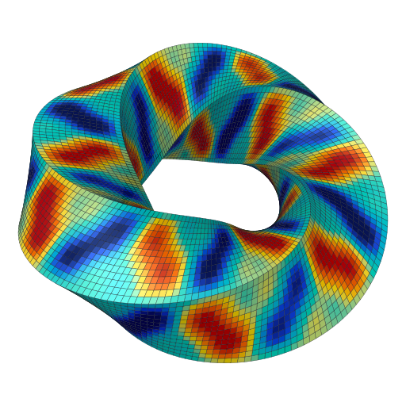
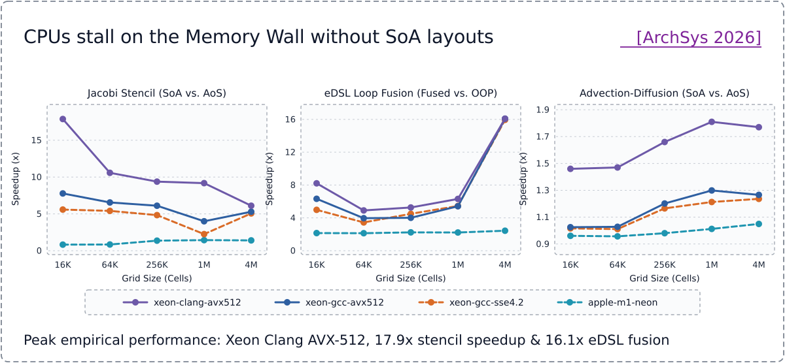

# ArchSys Solvers

**Computer Architecture Systems & High-Performance Scientific Computing**

  <em>Engineering zero-overhead scientific solvers and computational systems designed from the silicon memory hierarchy up.</em>

---

### About ArchSys Solvers

**ArchSys Solvers** is an open research and engineering initiative dedicated to bridging the divide between algorithmic computational mathematics and modern computer architecture. 

As microprocessors encounter the physical constraints of the **Memory Wall** and power scaling, computational performance is increasingly governed by memory layout, cache residency, and register vectorization rather than raw clock frequency. We investigate, build, and publish high-performance computational kernels, scientific solvers, and systems software engineered to extract peak efficiency from modern CPU and heterogeneous architectures.

---

### Core Research & Systems Domains

#### 1. Computer Architecture & Cache Memory Systems
* **Data-Oriented Design (DOD):** Transforming traditional object-oriented layouts (Array-of-Structures, AoS) into cache-optimal Structure-of-Arrays (SoA) and tiled Array-of-Structures-of-Arrays (AoSoA) memory patterns.
* **Cache Hierarchy Optimization:** Maximizing L1D spatial locality, minimizing private L2 miss penalties, and mitigating shared Last-Level Cache (LLC) contention.
* **Hardware Performance Telemetry:** In-depth microarchitectural profiling using hardware performance counters (PMU) to measure Instructions Per Cycle (IPC), cache miss ratios, and memory bus saturation.

#### 2. Modern Systems C++ & Metaprogramming
* **Zero-Cost Abstractions:** Utilizing C++17, C++20, and C++23 template metaprogramming, concepts, and compile-time evaluation to provide expressive mathematical APIs with zero runtime overhead.
* **Expression Templates & Embedded DSLs:** Eliminating intermediate vector allocations by fusing arithmetic expressions into single-pass hardware loops directly inside vector registers.
* **Hardware-Conscious Memory Management:** Cache-line aligned dynamic allocators, huge pages support, and NUMA-aware allocation strategies.

#### 3. High-Performance Computing (HPC) & Solvers
* **Scientific Simulation Kernels:** Iterative linear system solvers, sparse/dense matrix operators, stencil computations, and numerical differential equation discretizations.
* **Cross-ISA Hardware Vectorization:** Portable SIMD acceleration targeting 512-bit ZMM (x86 AVX-512), 256-bit YMM (AVX2), 128-bit (ARM NEON), and RISC-V Vector (RVV) extensions.
* **Parallel Execution Models:** Scalable multi-core parallelism using thread pools, lock-free work-stealing schedulers, and NUMA-domain thread affinity.

---

### Empirical Performance Highlights

  

---

### Architecture Landscape & Hardware Validation

All computational kernels and solver implementations are empirically benchmarked across diverse hardware platforms:

| Architecture | Microarchitecture / Platform | Vector Engine | Key Characteristics |
| :--- | :--- | :--- | :--- |
| **x86-64** | Intel Xeon / Core i9 (Cascade Lake) | 512-bit AVX-512 F/CD/BW/DQ/VL | Wide vector registers, high memory bandwidth, 19.25 MB L3 |
| **x86-64** | AMD Ryzen / EPYC (Zen) | 256-bit AVX2 + FMA3 | High core density, modular chiplet architecture |
| **Server ARM64** | Ampere Altra (Neoverse-N1) | Dual 128-bit NEON | Sustained 3.0 GHz server cores, 1 MB private L2 per core |
| **Client ARM64** | Apple Silicon M-series | 128-bit NEON / AMX | High-bandwidth unified memory architecture |
| **RISC-V** | RV64GCV Implementations | RISC-V Vector Extension (RVV) | Open-standard vector processing and research emulation |

---

### Repositories & Initiatives

* [**data-oriented-solver**](https://github.com/archsys-solvers/data-oriented-solver): High-performance C++17 scientific computing engine evaluating Data-Oriented Design (AoS vs. SoA vs. AoSoA), CPU cache efficiency, AVX-512 / NEON vectorization, and expression template loop fusion.
  * [Interactive Documentation & Benchmarks](https://archsys-solvers.github.io/data-oriented-solver/)
* **Hardware Probing & Telemetry:** Native C++ microarchitectural probe libraries extracting CPU topology, cache line sizes, and vector execution capabilities across Linux, macOS, and BSD systems.
* **Future Computational Solvers:** Generalizing data-oriented stencil frameworks and high-order iterative solvers for scientific computing.

---

  Founded & Maintained by <a href="https://github.com/ahmedez-zouine">Ahmed EZ-ZOUINE</a>
   
  Academic & Scientific Inquiries: <code>ahmed.ezzouine@um5r.ac.ma</code>

